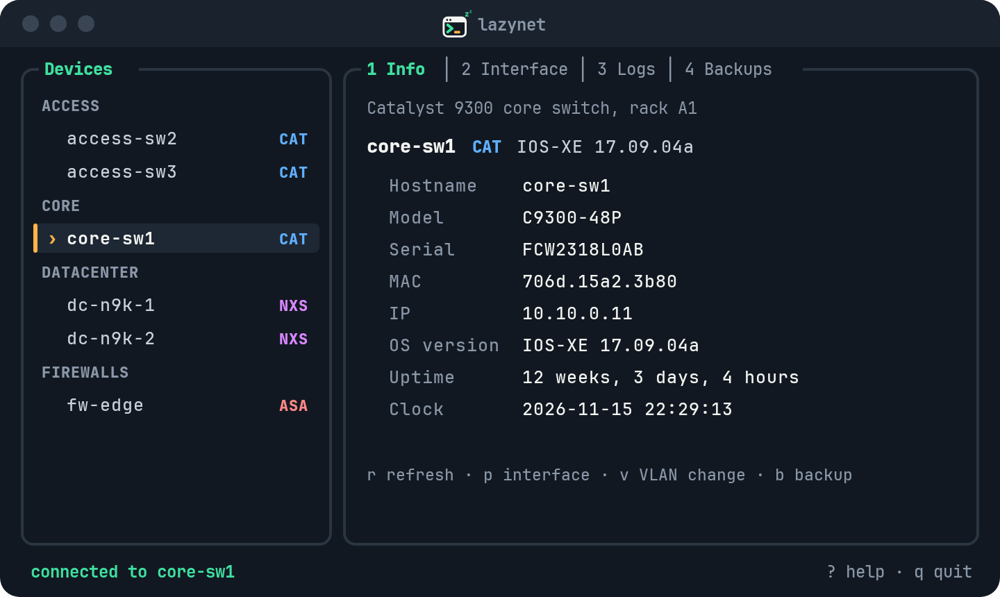
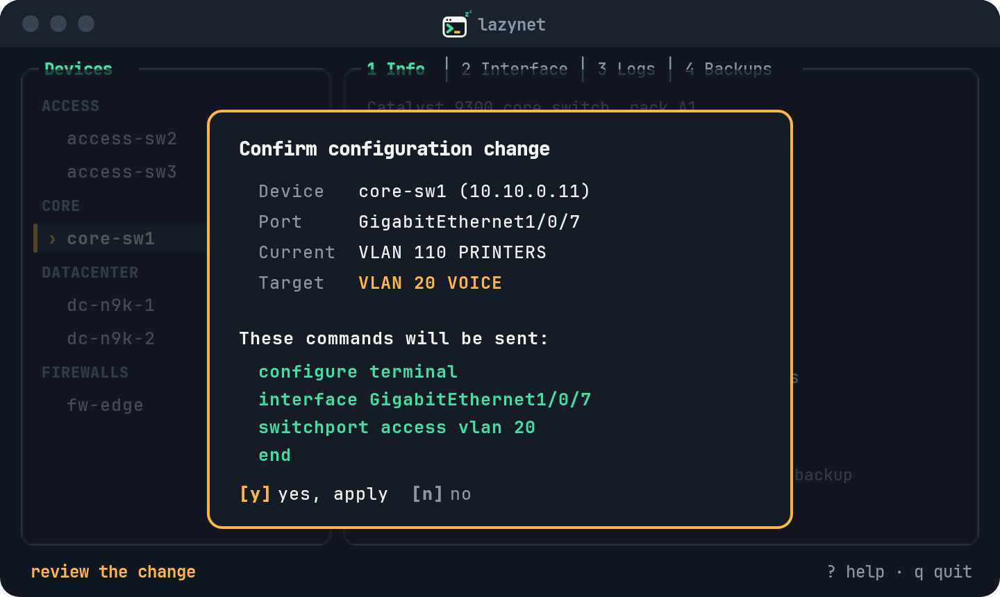

<p align="center">
  <picture>
    <source media="(prefers-color-scheme: dark)" srcset="assets/lazynet-lockup-dark-transparent.svg">
    
  </picture>
</p>

<p align="center">
  <b>Una TUI y CLI para Cisco Catalyst, Nexus y ASA, con backups de firewalls Palo Alto.</b><br>
  Consulta equipos, revisa logs, respalda configuraciones y cambia VLANs de acceso con seguridad, desde una sola terminal.
</p>

<p align="center">
  <a href="https://github.com/Camilo-ovalle/lazynet/actions/workflows/ci.yml"></a>
  <a href="https://github.com/Camilo-ovalle/lazynet/releases"></a>
  
  
  <a href="LICENSE"></a>
</p>

<p align="center">
  <a href="#instalación">Instalación</a> ·
  <a href="#primeros-pasos">Primeros pasos</a> ·
  <a href="#uso">Uso</a> ·
  <a href="#modelo-de-seguridad">Seguridad</a> ·
  <a href="#configuración">Configuración</a> ·
  <a href="README.md">English</a>
</p>

<p align="center">
  
</p>

## ¿Por qué lazynet?

Responder "¿en qué VLAN está ese puerto?" o "¿qué pasó anoche en este switch?" suele implicar varios pasos:
- abrir una sesión SSH;
- recordar el comando `show` correcto para esa plataforma;
- buscar en la salida y copiar los valores a un ticket.

Cambiar una VLAN de acceso suma además el riesgo de equivocarse en modo de configuración.

lazynet pone esas tareas del día a día detrás de una interfaz rápida, manejable con teclado y mouse, en la línea de [lazygit](https://github.com/jesseduffield/lazygit) y [lazydocker](https://github.com/jesseduffield/lazydocker). Es **de solo lectura por diseño**. El único cambio que puede hacer es el de VLAN de acceso, y en ese caso:
1. valida el puerto y la VLAN;
2. te muestra los comandos exactos;
3. espera tu confirmación;
4. verifica el resultado en el equipo;
5. registra todo en un log de auditoría.

## Contenido

- [Funcionalidades](#funcionalidades)
- [Plataformas soportadas](#plataformas-soportadas)
- [Instalación](#instalación)
- [Primeros pasos](#primeros-pasos)
- [Uso](#uso)
  - [Línea de comandos](#línea-de-comandos)
  - [Interfaz de terminal](#interfaz-de-terminal)
- [Modelo de seguridad](#modelo-de-seguridad)
- [Configuración](#configuración)
- [Solución de problemas](#solución-de-problemas)
- [Desarrollo](#desarrollo)
- [Hoja de ruta](#hoja-de-ruta)
- [Agradecimientos](#agradecimientos)
- [Licencia](#licencia)

## Funcionalidades

- **Dos interfaces, una herramienta:**
  - `lazynet` abre una TUI interactiva con teclado y mouse;
  - los subcomandos sirven para tareas rápidas y scripts, con `-o json` para salida procesable.
- **Información del equipo:** modelo, serial, MAC, IP de gestión, versión de OS, uptime y reloj. Funciona con un equipo o con un grupo completo del inventario en paralelo.
- **Consulta de interfaces:** estado, VLAN de acceso, velocidad y dúplex, contadores de errores y descripción. Acepta abreviaturas como `1/0/25` o `gi1/0/25`.
- **Logs por rango de tiempo:**
  - filtra el buffer del equipo con `--from` / `--to` o `--last 2h`, y por texto y severidad;
  - entiende las marcas de tiempo de IOS, IOS-XE, NX-OS y ASA;
  - cuando el año falta, lo deduce del reloj del equipo.
- **Backups versionados:**
  - guarda el `running-config` en un repositorio git local;
  - solo crea una versión nueva si algo cambió;
  - muestra diffs entre versiones.
- **Cambios de VLAN de acceso seguros** en switches Catalyst:
  - rechaza puertos trunk y VLANs inexistentes;
  - pide confirmar los comandos exactos;
  - verifica el resultado en el equipo;
  - pregunta aparte antes del `write memory`;
  - audita cada intento.
- **Detección automática de plataforma:** le das una IP y lazynet averigua si es Catalyst, Nexus, ASA o un firewall Palo Alto.
- **También firewalls Palo Alto:** información del equipo y backups versionados de la configuración (XML nativo de PAN-OS, el formato que el firewall importa), por la misma sesión SSH de solo lectura.
- **Credenciales como `sudo`:** las contraseñas se piden y nunca se escriben en disco. Se recuerdan 5 minutos en el keyring del kernel de Linux.
- **Sin dependencias:** un único binario estático, con SSH y git integrados.
- **Modo demo:** `lazynet --demo` levanta equipos emulados en localhost, para probar todo sin red.

## Plataformas soportadas

| Funcionalidad | Catalyst (IOS / IOS-XE) | Nexus (NX-OS) | ASA | Palo Alto (PAN-OS) |
|---|:---:|:---:|:---:|:---:|
| Detección de plataforma | ✅ | ✅ | ✅ | ✅ |
| Información del equipo | ✅ | ✅ | ✅ | ✅ |
| Consulta de interfaces | ✅ | ✅ | ✅ | — |
| Logs por rango de tiempo | ✅ | ✅ | ✅ | — |
| Backup y diff de configuración | ✅ | ✅ | ✅ | ✅ (XML) |
| Cambio de VLAN de acceso | ✅ | — | — | — |

Probado con la salida de Catalyst C9200L-48P-4X con IOS XE 17.12.04. En Palo Alto, lazynet entra en modo operativo y solo ejecuta comandos `show`, más `set cli pager off`, que desactiva la paginación de su propia sesión.

lazynet funciona en **Linux** (amd64 y arm64). El soporte para Windows y PowerShell está en la [hoja de ruta](#hoja-de-ruta).

> [!NOTE]
> lazynet está en desarrollo temprano. Los parsers se prueban con salidas reales capturadas de cada plataforma, y las pruebas en equipos de laboratorio están en curso. Si la salida de tus equipos no se interpreta bien, [abre un issue](https://github.com/Camilo-ovalle/lazynet/issues).

## Instalación

lazynet es un único binario estático, sin dependencias. Hay releases para **Linux amd64 y arm64**.

```sh
curl -fsSL https://raw.githubusercontent.com/Camilo-ovalle/lazynet/main/scripts/install.sh | sh
```

Con eso basta para la mayoría. Para actualizar más adelante, ejecuta `lazynet update`.

| Método | Ideal para | Cómo se actualiza |
|---|---|---|
| [Script de instalación](#script-de-instalación) (recomendado) | Cualquier distribución Linux | `lazynet update`, o volviendo a ejecutar el script |
| [Paquete .deb / .rpm](#paquetes-deb-y-rpm) | Equipos administrados con paquetes | `lazynet update` |
| [Tarball](#tarball) | Instalación manual o sin internet | `lazynet update`, o reemplazando el binario |
| [go install](#go-install) | Desarrolladores Go | `lazynet update`, o `go install …@latest` |
| [Desde el código](#compilar-desde-el-código) | Quien contribuye | `git pull && make build` |

### Script de instalación

Funciona en cualquier distribución Linux:

```sh
curl -fsSL https://raw.githubusercontent.com/Camilo-ovalle/lazynet/main/scripts/install.sh | sh
```

El [script](scripts/install.sh):
- detecta la arquitectura de tu CPU y descarga el último release;
- verifica su checksum SHA-256;
- instala el binario en `/usr/local/bin` (con `sudo` si hace falta) o en `~/.local/bin`;
- si lazynet ya está instalado, lo reemplaza donde está, así que volver a ejecutar el script lo actualiza.

| Variable | Efecto |
|---|---|
| `LAZYNET_VERSION=0.1.0` | Instala una versión específica en lugar de la última |
| `LAZYNET_INSTALL_DIR=$HOME/bin` | Instala en otro directorio |

```sh
curl -fsSL https://raw.githubusercontent.com/Camilo-ovalle/lazynet/main/scripts/install.sh | LAZYNET_VERSION=0.1.0 sh
```

Para desinstalar, borra el binario: `sudo rm "$(command -v lazynet)"`.

<details>
<summary><b>¿Instalaste lazynet 0.1.0 desde el repositorio APT?</b></summary>

El repositorio APT se retiró: era difícil de configurar y confuso para la mayoría. Quítalo y luego instala con el script:

```sh
sudo apt remove lazynet
sudo rm /etc/apt/sources.list.d/lazynet.list /usr/share/keyrings/lazynet.gpg
curl -fsSL https://raw.githubusercontent.com/Camilo-ovalle/lazynet/main/scripts/install.sh | sh
```

Mientras no lo hagas, `apt update` muestra un error para el repositorio antiguo. Tu inventario, backups y ajustes no se ven afectados.

</details>

### Paquetes .deb y .rpm

Úsalos si prefieres que tu gestor de paquetes lleve el control de los archivos de lazynet. El número de versión está en la [página de releases](https://github.com/Camilo-ovalle/lazynet/releases).

```sh
VERSION=0.1.0
ARCH=amd64        # o arm64
BASE=https://github.com/Camilo-ovalle/lazynet/releases/download/v$VERSION
```

```sh
# Debian, Ubuntu
curl -fLO "$BASE/lazynet_${VERSION}_linux_${ARCH}.deb"
sudo apt install "./lazynet_${VERSION}_linux_${ARCH}.deb"

# Fedora, RHEL, Rocky, Alma
sudo dnf install "$BASE/lazynet_${VERSION}_linux_${ARCH}.rpm"
```

Los paquetes instalan el binario en `/usr/bin`, junto con el autocompletado y los archivos de licencia. `lazynet update` descarga el paquete nuevo y lo instala con `dpkg` o `rpm`.

### Tarball

```sh
curl -fLO "$BASE/lazynet_${VERSION}_linux_${ARCH}.tar.gz"
curl -fLO "$BASE/checksums.txt"
sha256sum --check --ignore-missing checksums.txt
tar -xzf "lazynet_${VERSION}_linux_${ARCH}.tar.gz"
sudo install -m 0755 lazynet /usr/local/bin/lazynet
```

El archivo también incluye `LICENSE`, `NOTICE`, los README y el autocompletado (`completions/`).

### go install

Requiere Go 1.26 o superior. Instala en `$(go env GOPATH)/bin`:

```sh
go install github.com/Camilo-ovalle/lazynet/cmd/lazynet@latest    # o @v0.1.0
```

### Compilar desde el código

Requiere Go 1.26 o superior.

```sh
git clone https://github.com/Camilo-ovalle/lazynet.git
cd lazynet
make build        # genera ./lazynet
```

### Autocompletado

Los paquetes `.deb` y `.rpm` lo configuran solos. Con cualquier otro método, genéralo una vez. El autocompletado también sugiere los nombres de los equipos de tu inventario.

```sh
lazynet completion bash | sudo tee /usr/share/bash-completion/completions/lazynet >/dev/null
lazynet completion zsh  > "${fpath[1]}/_lazynet"
lazynet completion fish > ~/.config/fish/completions/lazynet.fish
```

### Verificar la instalación

```sh
lazynet version
lazynet --demo     # pruébalo de inmediato con equipos emulados
```

### Actualizar

```sh
lazynet update           # instala la última versión
lazynet update --check   # solo indica si hay una nueva
lazynet changelog        # qué cambió en cada versión
```

`lazynet update` actualiza lazynet de la misma forma en que lo instalaste:
- script de instalación, tarball o `go install`: reemplaza el binario donde está, exactamente como volver a ejecutar el script;
- paquete `.deb` o `.rpm`: descarga el paquete nuevo y lo instala con `dpkg` o `rpm`.

Cada descarga se verifica contra los checksums SHA-256 de la versión antes de usarla. `sudo` pide tu contraseña cuando la ubicación de la instalación requiere root.

La TUI consulta GitHub como máximo una vez al día y te avisa cuando sale una versión nueva. Pulsa `u` para actualizar (lazynet se cierra, se actualiza y vuelve a abrirse), `s` para saltar esa versión, o `esc` para decidir más tarde. El aviso espera a que no haya ninguna operación ni confirmación en curso. Después de actualizar, la TUI muestra qué cambió. En redes sin acceso a internet, pon `check_updates: false` en `config.yml`. El modo demo nunca consulta.

## Primeros pasos

**1. Pruébalo sin red.** El modo demo levanta un Catalyst, un Nexus y un ASA emulados en localhost. No toca tu red, tu keyring ni tus archivos.

```sh
lazynet --demo
```

**2. Crea tu inventario.**

```sh
lazynet inventory init          # escribe un ejemplo en ~/.config/lazynet/inventory.yml
$EDITOR "$(lazynet inventory path)"
lazynet inventory check --reach # valida el archivo y prueba la conectividad TCP
```

**3. Abre la TUI.**

```sh
lazynet
```

## Uso

### Línea de comandos

```sh
lazynet info core-sw1                         # modelo, serial, MAC, IP, versión de OS, uptime
lazynet info --group core -o json             # un grupo completo, en JSON
lazynet iface core-sw1 -p 1/0/25              # una interfaz (Gi1/0/25, gi1/0/25 y 1/0/25 funcionan igual)
lazynet logs core-sw1 --last 2h --severity warning
lazynet logs core-sw1 --from "2026-11-01 08:00" --to "2026-11-01 18:00" --grep UPDOWN
lazynet backup --group core                   # o un solo equipo, o --all
lazynet backup diff core-sw1                  # qué cambió desde el backup anterior
lazynet vlan set core-sw1 -p 1/0/7 -v 20      # validado, confirmado, verificado y auditado
```

| Comando | Descripción |
|---|---|
| `info [equipo] [--group G]` | Información del equipo |
| `iface <equipo> -p PUERTO [--raw]` | Detalle de la interfaz, o la salida cruda del `show` |
| `logs <equipo> [--from T --to T \| --last D] [--grep S] [--severity L]` | Logs filtrados del equipo |
| `backup [equipo] [--group G \| --all]` | Guarda el `running-config` en el repositorio de backups |
| `backup list \| show \| diff <equipo>` | Consulta y compara backups |
| `vlan set <equipo> -p PUERTO -v VLAN` | Cambia una VLAN de acceso (Catalyst) |
| `inventory list \| add \| check \| init \| path` | Administra el inventario |
| `update [--check]` | Actualiza lazynet a la última versión |
| `changelog [--since V]` | Notas de cada versión |
| `completion bash \| zsh \| fish` | Autocompletado, incluidos los nombres de equipos |

Opciones globales:
- `-u` cambia el usuario SSH;
- `--ssh-port` cambia el puerto SSH;
- `-o json` da salida procesable;
- `--demo` usa los equipos emulados.

Un equipo puede ser un nombre del inventario, una IP o `host:puerto`.

### Interfaz de terminal

| Tecla | Acción | Tecla | Acción |
|---|---|---|---|
| `↑` `↓` / `j` `k` | Moverse, hacer scroll | `tab` / `h` `l` | Cambiar de panel |
| `1`–`4` / `[` `]` | Info · Interface · Logs · Backups | `enter` | Conectar, cargar |
| `p` | Consultar una interfaz | `v` | Cambiar una VLAN de acceso |
| `b` | Tomar un backup | `a` | Conectar a una IP fuera del inventario |
| `f` · `/` · `s` | Logs: rango de tiempo · texto · severidad | `r` | Refrescar |
| `?` | Ayuda | `q` | Salir |

Con el mouse puedes hacer clic en equipos y pestañas, y desplazarte con la rueda.

## Modelo de seguridad

<p align="center">
  
</p>

lazynet está pensado para que cualquiera del equipo pueda usarlo sin riesgo. Las garantías están implementadas en el código, no dependen de buenas prácticas.

**Transporte de solo lectura.** La capa SSH solo envía comandos `show …` y ajustes de sesión (`terminal length 0`, `terminal width`, `terminal pager 0`). Cualquier otra cosa se rechaza antes de llegar al equipo, incluidas las redirecciones como `| redirect`, `| tee` y `> archivo`, y los caracteres de control.

**El único cambio que lazynet puede hacer** es el de VLAN de acceso en un switch Catalyst:

1. El nombre del puerto se normaliza y se valida estrictamente, así que una entrada como `1/0/1;reload` se rechaza.
2. Primero se hacen chequeos de solo lectura:
   - `show interfaces <puerto> switchport` rechaza los puertos configurados como trunk o que operan como trunk, incluido un trunk negociado con DTP. Los puertos en modo `dynamic auto` o `dynamic desirable` (el valor por defecto en Catalyst) se pueden cambiar mientras estén caídos o funcionando como access: solo se cambia la VLAN de acceso, y la confirmación advierte que el puerto sigue negociando;
   - `show vlan brief` confirma que la VLAN exista y esté activa;
   - las VLANs reservadas se rechazan.
3. lazynet muestra el equipo, el puerto, la VLAN actual y la nueva, y los comandos **exactos**. Luego espera una `y` explícita. `Enter` nunca aprueba un cambio.
4. Solo se pueden enviar las líneas que confirmaste. La TUI vuelve a revisar el puerto justo antes de aplicar; si algo cambió desde que lo revisaste, no se envía nada.
5. lazynet vuelve a leer el puerto para verificar el cambio.
6. Una pregunta aparte confirma el `write memory`. Mientras no guardes, el cambio solo existe en el `running-config`.
7. Cada intento (rechazado, aplicado o fallido) se agrega a `~/.local/share/lazynet/audit.log` en formato JSON lines. Cada registro incluye usuario local, usuario del equipo, host, puerto, VLAN anterior y nueva, comandos y resultado.

No existe un flag `--yes`.

**Credenciales y SSH.**
- Las contraseñas nunca se escriben en disco. Se guardan 5 minutos en el keyring del kernel de Linux, que las expira solo, y cada uso renueva el plazo. Con `credential_ttl: 0` se guardan solo en memoria.
- Las llaves de host se confían en el primer uso (TOFU) y se guardan en el `known_hosts` propio de lazynet. lazynet verifica la llave *antes* de pedir la contraseña. Si la llave cambia, es un error y la conexión no sigue.
- Se requiere un login con privilegio 15 (prompt `#`). Las cuentas que entran en `>` reciben un error claro, en lugar de una sesión a medias.

## Configuración

lazynet sigue la especificación XDG de directorios. Con `LAZYNET_HOME` puedes guardar todo bajo una sola carpeta.

| Ruta | Contenido |
|---|---|
| `~/.config/lazynet/inventory.yml` | Equipos y grupos |
| `~/.config/lazynet/config.yml` | Ajustes (opcional) |
| `~/.config/lazynet/known_hosts` | Llaves SSH confiables |
| `~/.local/share/lazynet/backups/` | Repositorio git con una carpeta por equipo |
| `~/.local/share/lazynet/audit.log` | Log de auditoría de cambios (JSON lines) |
| `~/.local/share/lazynet/update.json` | Notas de versión ya mostradas, versión saltada, última consulta de actualizaciones |
| `~/.cache/lazynet/detected.json` | Caché de detección de plataforma |

<details>
<summary><b>inventory.yml</b></summary>

```yaml
defaults:
  username: admin
  # port: 22

devices:
  - name: core-sw1
    host: 10.10.0.11
    group: core
    description: Catalyst 9300 core switch, rack A1
  - name: dc-n9k-1
    host: 10.10.0.21
    group: datacenter
  - name: fw-edge
    host: 10.10.0.1
    group: firewalls
    username: fwadmin
    platform: asa        # opcional: omite la detección automática (catalyst, nexus, asa, paloalto)
  - name: pa-fw1
    host: 10.10.0.2
    group: firewalls
```

`lazynet inventory add` agrega un equipo conservando tus comentarios y formato.

</details>

<details>
<summary><b>config.yml</b></summary>

```yaml
credential_ttl: 5m     # cuánto se recuerdan las contraseñas; 0 = solo mientras lazynet corre
workers: 5             # sesiones en paralelo para --group / --all
ssh_timeout: 15s
command_timeout: 90s
default_username: ""
legacy_ssh: true       # ofrece también algoritmos antiguos (CBC, group14-sha1, ssh-rsa) después de los modernos
check_updates: true    # la TUI consulta GitHub por versiones nuevas, como máximo una vez al día
```

</details>

## Solución de problemas

<details>
<summary><b>"logged in at user EXEC (>)"</b></summary>

lazynet necesita privilegio 15. Dale `privilege 15` a la cuenta, o usa autorización AAA que la deje en nivel 15 al entrar. El soporte para modo `enable` está en la hoja de ruta.

</details>

<details>
<summary><b>Falla la negociación SSH con un switch antiguo</b></summary>

Las imágenes IOS antiguas pueden ofrecer solo cifrados CBC, `diffie-hellman-group14-sha1` o llaves de host `ssh-rsa`. Están habilitados por defecto, después de los algoritmos modernos. Revisa que `legacy_ssh` no esté en `false`. Revisa también que el equipo tenga una llave RSA de al menos 2048 bits (`crypto key generate rsa modulus 2048`).

</details>

<details>
<summary><b>"host key changed"</b></summary>

El equipo presentó una llave distinta a la que confiaste antes. Puede ser legítimo, por ejemplo tras un RMA o si se regeneró la llave. Confírmalo con el responsable del equipo y luego borra la línea anterior de `~/.config/lazynet/known_hosts`.

</details>

<details>
<summary><b>Se omiten entradas de log "without date"</b></summary>

El equipo marca los logs con su uptime en lugar de la fecha. Configura `service timestamps log datetime msec localtime year` para poder filtrarlos por fecha.

</details>

<details>
<summary><b>La TUI tarda unos segundos en arrancar</b></summary>

Al iniciar, la TUI le pregunta a la terminal su color de fondo. Algunas terminales no responden esa consulta, y la TUI espera hasta que vence un tiempo de espera corto. Las terminales modernas, como Windows Terminal, kitty, Alacritty o GNOME Terminal, responden de inmediato.

</details>

## Desarrollo

```sh
make test     # tests unitarios y de integración contra equipos SSH emulados
make build    # binario estático en ./lazynet
make demo     # compila y abre la TUI en modo demo
go run ./cmd/lazynet mock --platform catalyst --listen 127.0.0.1:2222   # equipo falso independiente
```

<details>
<summary><b>Estructura del proyecto</b></summary>

| Ruta | Función |
|---|---|
| `cmd/lazynet` | Punto de entrada |
| `internal/cli` | Subcomandos (Cobra) |
| `internal/tui` | Interfaz Bubble Tea |
| `internal/app` | Flujo de conexión, credenciales, backups y orquestación del cambio de VLAN |
| `internal/platform` | Contrato y registro de plataformas: drivers, capacidades opcionales, badges |
| `internal/platforms/…` | Un paquete por familia de equipos (`cisco/catalyst`, `cisco/nexus`, `cisco/asa`, `paloalto`): driver, parsers y tests |
| `internal/detect` | Identifica la plataforma de una sesión nueva con las sondas que declara cada plataforma |
| `internal/transport` | Sesiones SSH sin lógica de fabricante, guardia de solo lectura, cambios confirmados, llaves de host |
| `internal/parse` | Parsers compartidos por varias plataformas (interfaces, logs, relojes) |
| `internal/mockssh` | Servidor SSH que emula el CLI de cada plataforma (tests y modo demo) |
| `internal/backup`, `internal/audit`, `internal/creds` | Backups en git, log de auditoría, caché de credenciales |
| `internal/update` | Consulta de versiones, `lazynet update`, notas de versión del `CHANGELOG.md` embebido |
| `assets/` | Logo, íconos e imágenes del README ([generador](assets/assets-generator)) |
| `site/` | Página de presentación ([camilo-ovalle.github.io/lazynet](https://camilo-ovalle.github.io/lazynet)), hecha con Astro |

</details>

Los releases se construyen con [GoReleaser](https://goreleaser.com) al subir un tag `v*`. Sus notas salen de [CHANGELOG.md](CHANGELOG.md) (en inglés), que también va embebido en el binario para el aviso "What's new" de la TUI. Los pasos para publicar y el funcionamiento de las actualizaciones están en [docs/releasing.md](docs/releasing.md) (en inglés).

Por ahora, la contribución más valiosa son reportes de bugs que incluyan la salida `show` de tus equipos, sin datos sensibles. Esas salidas se convierten en fixtures para los tests de los parsers.

## Hoja de ruta

- [ ] Soporte para Windows y PowerShell (Credential Manager)
- [ ] Modo `enable` para cuentas con privilegio menor a 15
- [ ] Jump hosts / bastiones
- [ ] Logs desde un servidor syslog
- [ ] Restaurar backups
- [ ] Cambios de VLAN en Nexus
- [ ] Palo Alto: interfaces y logs

## Agradecimientos

- [lazygit](https://github.com/jesseduffield/lazygit) y [lazydocker](https://github.com/jesseduffield/lazydocker), la inspiración de la interfaz.
- [Bubble Tea](https://github.com/charmbracelet/bubbletea), [Lip Gloss](https://github.com/charmbracelet/lipgloss) y [Bubbles](https://github.com/charmbracelet/bubbles), de Charm.
- [scrapligo](https://github.com/scrapli/scrapligo), [go-git](https://github.com/go-git/go-git) y [Cobra](https://github.com/spf13/cobra).

lazynet es un proyecto independiente, sin afiliación ni respaldo de Cisco Systems ni de Palo Alto Networks. Cisco, Catalyst y Nexus son marcas registradas de Cisco Systems, Inc. Palo Alto Networks y PAN-OS son marcas registradas de Palo Alto Networks, Inc.

## Licencia

Copyright 2026 Camilo Enrique Ovalle Ceron.

lazynet se distribuye bajo la [Licencia Apache, versión 2.0](LICENSE). Se entrega **"tal cual", sin garantías ni condiciones de ningún tipo**. Consulta la licencia para ver los términos completos, incluida la limitación de responsabilidad. Toda redistribución debe conservar el aviso de copyright y el archivo [NOTICE](NOTICE).
