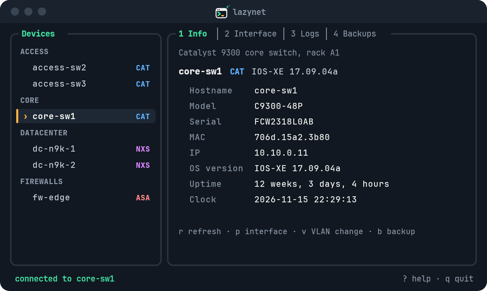
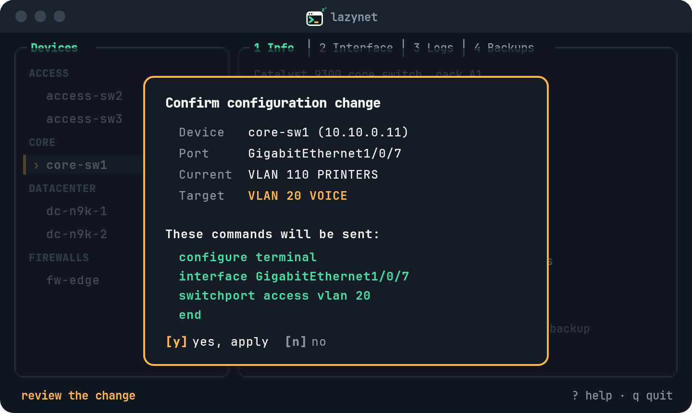

<p align="center">
  <picture>
    <source media="(prefers-color-scheme: dark)" srcset="assets/lazynet-lockup-dark-transparent.svg">
    
  </picture>
</p>

<p align="center">
  <b>A terminal UI and CLI for Cisco Catalyst, Nexus and ASA.</b><br>
  Inspect devices, read logs, back up configs and change access VLANs safely, from one terminal.
</p>

<p align="center">
  <a href="https://github.com/Camilo-ovalle/Lazy_Net/actions/workflows/ci.yml"></a>
  <a href="https://github.com/Camilo-ovalle/Lazy_Net/releases"></a>
  
  
</p>

<p align="center">
  <a href="#installation">Installation</a> ·
  <a href="#quick-start">Quick start</a> ·
  <a href="#usage">Usage</a> ·
  <a href="#safety-model">Safety model</a> ·
  <a href="#configuration">Configuration</a> ·
  <a href="README.es.md">Español</a>
</p>

<p align="center">
  
</p>

## Why lazynet?

Answering "what VLAN is that port in?" or "what happened on this switch last night?" usually means opening an SSH session, finding the right `show` command for that platform, scrolling through output and copying values into a ticket. Changing an access VLAN adds the risk of a typo in configuration mode.

lazynet puts those everyday tasks behind a fast keyboard- and mouse-driven interface, in the spirit of [lazygit](https://github.com/jesseduffield/lazygit) and [lazydocker](https://github.com/jesseduffield/lazydocker). It is **read-only by design**. The only change it can make is an access-VLAN change. That change is validated first, then you see the exact commands and must confirm them. After it runs, lazynet verifies the result and writes an audit log entry.

## Table of contents

- [Features](#features)
- [Supported platforms](#supported-platforms)
- [Installation](#installation)
- [Quick start](#quick-start)
- [Usage](#usage)
  - [Command line](#command-line)
  - [Terminal UI](#terminal-ui)
- [Safety model](#safety-model)
- [Configuration](#configuration)
- [Troubleshooting](#troubleshooting)
- [Development](#development)
- [Roadmap](#roadmap)
- [Acknowledgments](#acknowledgments)
- [License](#license)

## Features

- **Two interfaces, one tool.** Run `lazynet` for an interactive TUI with keyboard and mouse support. Use subcommands for quick, scriptable tasks, with `-o json` for machine-readable output.
- **Device info at a glance.** Shows model, serial, MAC, management IP, OS version, uptime and clock, for one device or a whole inventory group in parallel.
- **Interface lookup.** Shows status, access VLAN, speed and duplex, error counters and description. Shorthand such as `1/0/25` or `gi1/0/25` is accepted.
- **Logs by time range.** Filters the device log buffer with `--from` / `--to` or `--last 2h`, plus text and severity filters. It understands IOS, IOS-XE, NX-OS and ASA timestamps, and infers missing years from the device clock.
- **Versioned config backups.** Stores `running-config` snapshots in a local git repository. A new version is created only when something changed, and lazynet shows unified diffs between versions.
- **Safe access-VLAN changes** on Catalyst switches. Trunk ports and missing VLANs are refused. You confirm the exact commands, the result is verified on the device, `write memory` is a separate prompt, and every attempt is audited.
- **Automatic platform detection.** Point it at an IP; lazynet works out whether it is a Catalyst, Nexus or ASA.
- **Credentials handled like `sudo`.** Passwords are prompted and never written to disk. They are remembered for 5 minutes in the Linux kernel keyring.
- **Zero dependencies.** lazynet is a single static binary with SSH and git built in.
- **Demo mode.** `lazynet --demo` starts emulated devices on localhost, so you can try every feature without a network.

## Supported platforms

| Feature | Catalyst (IOS / IOS-XE) | Nexus (NX-OS) | ASA |
|---|:---:|:---:|:---:|
| Platform detection | ✅ | ✅ | ✅ |
| Device info | ✅ | ✅ | ✅ |
| Interface lookup | ✅ | ✅ | ✅ |
| Logs by time range | ✅ | ✅ | ✅ |
| Config backup and diff | ✅ | ✅ | ✅ |
| Access-VLAN change | ✅ | — | — |

lazynet runs on **Linux** (amd64 and arm64). Windows and PowerShell support is on the [roadmap](#roadmap).

> [!NOTE]
> lazynet is in early development. Parsers are tested against captured output from each platform. Testing on lab hardware is in progress, so please [open an issue](https://github.com/Camilo-ovalle/Lazy_Net/issues) if output from your devices is not parsed correctly.

## Installation

> [!IMPORTANT]
> The first release has not been published yet. Until it is, use [Build from source](#build-from-source). The methods below will work as soon as `v0.1.0` is tagged.

<details open>
<summary><b>Install script</b> (any Linux distribution)</summary>

```sh
curl -fsSL https://raw.githubusercontent.com/Camilo-ovalle/Lazy_Net/main/scripts/install.sh | sh
```

The script downloads the latest release for your architecture, verifies its SHA-256 checksum and installs it into `/usr/local/bin` (or `~/.local/bin` without sudo). You can set these variables:

- `LAZYNET_VERSION=v0.1.0` to pin a version;
- `LAZYNET_INSTALL_DIR=...` to choose the install directory.

</details>

<details>
<summary><b>APT repository</b> (Debian, Ubuntu)</summary>

```sh
curl -fsSL https://camilo-ovalle.github.io/Lazy_Net/lazynet.gpg | sudo tee /usr/share/keyrings/lazynet.gpg >/dev/null
echo "deb [signed-by=/usr/share/keyrings/lazynet.gpg] https://camilo-ovalle.github.io/Lazy_Net stable main" | sudo tee /etc/apt/sources.list.d/lazynet.list
sudo apt update && sudo apt install lazynet
```

</details>

<details>
<summary><b>.deb / .rpm / tarball</b></summary>

Download a package from the [releases page](https://github.com/Camilo-ovalle/Lazy_Net/releases), then install it:

```sh
sudo apt install ./lazynet_*.deb   # Debian, Ubuntu
sudo dnf install ./lazynet-*.rpm   # Fedora, RHEL
```

The packages also install shell completions for bash, zsh and fish.

</details>

<details>
<summary><b>Go</b></summary>

```sh
go install github.com/Camilo-ovalle/Lazy_Net/cmd/lazynet@latest
```

</details>

### Build from source

Requires Go 1.26 or newer.

```sh
git clone https://github.com/Camilo-ovalle/Lazy_Net.git
cd Lazy_Net
make build        # produces ./lazynet
```

## Quick start

**1. Try it without a network.** Demo mode runs emulated Catalyst, Nexus and ASA devices on localhost. It doesn't touch your network, keyring or files.

```sh
lazynet --demo
```

**2. Create your inventory.**

```sh
lazynet inventory init          # writes an example to ~/.config/lazynet/inventory.yml
$EDITOR "$(lazynet inventory path)"
lazynet inventory check --reach # validates the file and tests TCP reachability
```

**3. Open the TUI.**

```sh
lazynet
```

## Usage

### Command line

```sh
lazynet info core-sw1                         # model, serial, MAC, IP, OS version, uptime
lazynet info --group core -o json             # a whole group, as JSON
lazynet iface core-sw1 -p 1/0/25              # one interface (Gi1/0/25, gi1/0/25 and 1/0/25 all work)
lazynet logs core-sw1 --last 2h --severity warning
lazynet logs core-sw1 --from "2026-11-01 08:00" --to "2026-11-01 18:00" --grep UPDOWN
lazynet backup --group core                   # or a single device, or --all
lazynet backup diff core-sw1                  # what changed since the previous backup
lazynet vlan set core-sw1 -p 1/0/7 -v 20      # validated, confirmed, verified, audited
```

| Command | Description |
|---|---|
| `info [device] [--group G]` | Device information |
| `iface <device> -p PORT [--raw]` | Interface details, or the raw `show` output |
| `logs <device> [--from T --to T \| --last D] [--grep S] [--severity L]` | Filtered device logs |
| `backup [device] [--group G \| --all]` | Save `running-config` into the backup repository |
| `backup list \| show \| diff <device>` | Browse and compare backups |
| `vlan set <device> -p PORT -v VLAN` | Change an access VLAN (Catalyst) |
| `inventory list \| add \| check \| init \| path` | Manage the inventory |
| `completion bash \| zsh \| fish` | Shell completion, including device names |

These options work with every command:
- `-u` to override the SSH username;
- `--ssh-port` to override the SSH port;
- `-o json` for machine-readable output;
- `--demo` to use the emulated devices.

A device can be an inventory name, an IP or `host:port`.

### Terminal UI

| Key | Action | Key | Action |
|---|---|---|---|
| `↑` `↓` / `j` `k` | Move, scroll | `tab` / `h` `l` | Switch pane |
| `1`–`4` / `[` `]` | Info · Interface · Logs · Backups | `enter` | Connect, load |
| `p` | Query an interface | `v` | Change an access VLAN |
| `b` | Take a backup | `a` | Connect to an IP not in the inventory |
| `f` · `/` · `s` | Logs: time range · text · severity | `r` | Refresh |
| `?` | Help | `q` | Quit |

You can also use the mouse: click devices and tabs, and scroll with the wheel.

## Safety model

<p align="center">
  
</p>

lazynet is meant to be safe to hand to anyone on a team. Its guarantees are enforced in code, not by convention.

**Read-only transport.** The SSH layer only sends `show …` commands and session settings (`terminal length 0`, `terminal width`, `terminal pager 0`). It rejects anything else before it reaches the device. That includes output redirection such as `| redirect`, `| tee` and `> file`, and control characters.

**The one change lazynet can make** is an access-VLAN change on a Catalyst switch:

1. The port name is normalized and strictly validated, so input like `1/0/1;reload` is rejected.
2. Read-only checks run first. `show interfaces <port> switchport` refuses trunk and dynamic ports. `show vlan brief` confirms the VLAN exists and is active, and reserved VLANs are refused.
3. lazynet shows the device, the port, the current and target VLAN, and the **exact** commands. It then waits for an explicit `y`. `Enter` alone never approves a change.
4. Only the lines you confirmed can be sent. The TUI re-checks the port right before applying; if anything changed since you reviewed it, nothing is sent.
5. lazynet reads the port back to verify the change.
6. A separate prompt asks before `write memory`. Until you save, the change exists only in `running-config`.
7. Every attempt (declined, applied or failed) is appended to `~/.local/share/lazynet/audit.log` as JSON lines. Each record includes the local user, device user, host, port, old and new VLAN, commands and result.

There is no `--yes` flag.

**Credentials and SSH.**
- Passwords are never written to disk. They are kept for a 5-minute sliding grace period in the Linux kernel keyring, which expires them on its own. Set `credential_ttl: 0` to keep them only in memory.
- Host keys follow trust-on-first-use and are stored in lazynet's own `known_hosts`. lazynet verifies the host key *before* it asks for a password. A changed key is a hard error.
- A privilege-15 login (`#` prompt) is required. Accounts that land at `>` get a clear error instead of a partial session.

## Configuration

lazynet follows the XDG base directory spec. Set `LAZYNET_HOME` to keep everything under one folder.

| Path | Content |
|---|---|
| `~/.config/lazynet/inventory.yml` | Devices and groups |
| `~/.config/lazynet/config.yml` | Settings (optional) |
| `~/.config/lazynet/known_hosts` | Trusted SSH host keys |
| `~/.local/share/lazynet/backups/` | Git repository with one folder per device |
| `~/.local/share/lazynet/audit.log` | Change audit log (JSON lines) |
| `~/.cache/lazynet/detected.json` | Cached platform detection |

<details>
<summary><b>inventory.yml</b></summary>

```yaml
defaults:
  username: admin
  # port: 22

devices:
  - name: core-sw1
    host: 10.10.0.11
    group: core
    description: Catalyst 9300 core switch, rack A1
  - name: dc-n9k-1
    host: 10.10.0.21
    group: datacenter
  - name: fw-edge
    host: 10.10.0.1
    group: firewalls
    username: fwadmin
    platform: asa        # optional: skips auto-detection
```

`lazynet inventory add` appends a device and keeps your comments and formatting.

</details>

<details>
<summary><b>config.yml</b></summary>

```yaml
credential_ttl: 5m     # how long passwords are remembered; 0 = only while lazynet runs
workers: 5             # parallel sessions for --group / --all
ssh_timeout: 15s
command_timeout: 90s
default_username: ""
legacy_ssh: true       # also offer older algorithms (CBC, group14-sha1, ssh-rsa) after modern ones
```

</details>

## Troubleshooting

<details>
<summary><b>"logged in at user EXEC (>)"</b></summary>

lazynet needs privilege 15. Give the account `privilege 15` (or use AAA authorization that places it at level 15 on login). Entering `enable` mode is on the roadmap.

</details>

<details>
<summary><b>SSH negotiation fails on an old switch</b></summary>

Older IOS images may only offer CBC ciphers, `diffie-hellman-group14-sha1` or `ssh-rsa` host keys. These are enabled by default, after the modern algorithms. Check that `legacy_ssh` is not set to `false`, and that the device has an RSA key of at least 2048 bits (`crypto key generate rsa modulus 2048`).

</details>

<details>
<summary><b>"host key changed"</b></summary>

The device presented a different key than the one you trusted before. This can be legitimate, for example after an RMA or a key regeneration. Confirm with the device owner, then remove the old line from `~/.config/lazynet/known_hosts`.

</details>

<details>
<summary><b>Log entries "without date" are skipped</b></summary>

The device stamps logs with uptime instead of the date. Configure `service timestamps log datetime msec localtime year` so log lines can be filtered by date.

</details>

<details>
<summary><b>The TUI takes a few seconds to start</b></summary>

Some terminals don't answer the background-color query that the TUI sends at startup, so it waits for a short timeout. Modern terminals such as Windows Terminal, kitty, Alacritty and GNOME Terminal answer immediately.

</details>

## Development

```sh
make test     # unit and integration tests against an emulated Cisco SSH server
make build    # static binary in ./lazynet
make demo     # build and run the TUI in demo mode
go run ./cmd/lazynet mock --platform catalyst --listen 127.0.0.1:2222   # standalone fake device
```

<details>
<summary><b>Project layout</b></summary>

| Path | Role |
|---|---|
| `cmd/lazynet` | Entry point |
| `internal/cli` | Cobra subcommands |
| `internal/tui` | Bubble Tea interface |
| `internal/app` | Connection flow, credentials, backups, VLAN change orchestration |
| `internal/device` | Platform drivers, detection, interface names, VLAN change planning |
| `internal/transport` | SSH sessions, read-only guard, confirmed change requests, host keys |
| `internal/parse` | Parsers for `show` output and log timestamps |
| `internal/mockssh` | SSH server that emulates Cisco CLI behaviour (tests and demo mode) |
| `internal/backup`, `internal/audit`, `internal/creds` | Git backups, audit log, credential cache |
| `assets/` | Logo, icons and README images ([generator](assets/assets-generator)) |

</details>

Releases are built with [GoReleaser](https://goreleaser.com) when a `v*` tag is pushed. The release workflow also publishes the signed APT repository to GitHub Pages. It needs the `APT_GPG_PRIVATE_KEY` and `APT_GPG_PASSPHRASE` repository secrets.

Bug reports with sanitized `show` output from your devices are the most valuable contribution right now. They become parser test fixtures.

## Roadmap

- [ ] Windows and PowerShell support (Credential Manager)
- [ ] `enable` mode for accounts below privilege 15
- [ ] Jump hosts / bastions
- [ ] Logs from a syslog server
- [ ] Restoring backups
- [ ] VLAN changes on Nexus

## Acknowledgments

- [lazygit](https://github.com/jesseduffield/lazygit) and [lazydocker](https://github.com/jesseduffield/lazydocker), the inspiration for the interface.
- [Bubble Tea](https://github.com/charmbracelet/bubbletea), [Lip Gloss](https://github.com/charmbracelet/lipgloss) and [Bubbles](https://github.com/charmbracelet/bubbles) by Charm.
- [scrapligo](https://github.com/scrapli/scrapligo), [go-git](https://github.com/go-git/go-git) and [Cobra](https://github.com/spf13/cobra).

lazynet is an independent project. It is not affiliated with or endorsed by Cisco Systems. Cisco, Catalyst and Nexus are trademarks of Cisco Systems, Inc.

## License

No license has been chosen yet. Until one is added, all rights are reserved.
